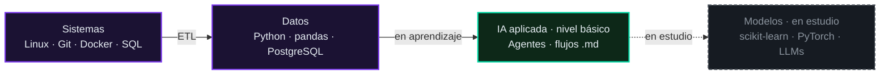

<!--
  PAUQUEN // README DE PERFIL
  Identidad: "pipeline" — el perfil se lee como el estado de un sistema en:
  sistemas → datos → IA.
  ANTES DE PUBLICAR: revisa el TODO de proyectos reales.
  Los niveles son orientativos: ajústalos a tu experiencia real.
-->

<div align="center">

```
 ____   _   _   _  ___  _   _ _____ _   _
|  _ \ / \ | | | |/ _ \| | | | ____| \ | |
| |_) / _ \| | | | | | | | | |  _| |  \| |
|  __/ ___ \ |_| | |_| | |_| | |___| |\  |
|_| /_/   \_\___/ \__\_\\___/|_____|_| \_|
```

<strong><code>sistemas</code> ──▶ <code>datos</code> ──▶ <code>inteligencia artificial</code></strong>

<em>Ingeniero de Sistemas con enfoque en Análisis de Datos e Inteligencia Artificial. Formación y desarrollo continuo.</em>

<br>

<a href="https://github.com/Pauquen"></a>
<a href="https://github.com/Pauquen"></a>
<a href="https://github.com/Pauquen"></a>
<a href="https://github.com/Pauquen"></a>

</div>

---

## `> whoami`

Soy **Paulo**, ingeniero de sistemas con orientación al análisis de datos y la inteligencia artificial.

Mi trayectoria se dirige a comprender el ciclo completo del dato —desde su origen hasta su uso en la toma de decisiones— y a especializarme en **análisis de datos e inteligencia artificial**. Mi formación combina el estudio teórico con la implementación práctica y la revisión iterativa.

> Principio de trabajo: *corrección funcional, claridad y escalabilidad, en ese orden.*

---

## `> pipeline`



🟢 **En práctica (nivel básico)** · 🟣 **En aprendizaje** · ⚪ **En estudio, sin experiencia práctica aún**

La especialización se plantea como un proceso continuo: los fundamentos de sistemas aportan rigor, los datos aportan contexto y la inteligencia artificial aporta herramientas para el análisis y la predicción.

---

## `> stack`

| Capa | Herramientas | Estado |
| :--- | :--- | :--- |
| **Sistemas** | Linux · Git · Docker · SQL | aprendiendo |
| **Datos** | Python · pandas · PostgreSQL · Power BI | aprendiendo |
| **IA — práctica** | Agentes · flujos de trabajo en Markdown · asistentes de código | nivel básico |
| **IA — en estudio** | scikit-learn · PyTorch · modelos de lenguaje | aprendiendo |

<div align="center">


</div>

---

## `> ahora`

```text
$ systemctl status Paulo
● Paulo — formación en datos e IA
   Active: en formación continua

   ▶ en estudio:    SQL analítico, limpieza de datos y modelos supervisados
   ▶ en práctica:   agentes y flujos de trabajo documentados en Markdown
   ▶ objetivo:      integrar un pipeline de datos, modelo y decisión
```

---

## `> laboratorio`

Repositorios disponibles para revisión:

- [Pauquen](https://github.com/Pauquen/Pauquen) — repositorio de este perfil, en revisión continua.

<!-- TODO: agrega 2 o 3 repositorios reales: un análisis de datos, un modelo y algo de sistemas. -->

> Los proyectos en curso forman parte del portafolio y documentan el proceso de formación.

---

## `> log`

```text
commit  inicial  — Ingeniería de Sistemas: fundamentos
commit  actual   — Análisis de Datos e IA: en formación
commit  próximo  — integración de un pipeline de datos, modelo y decisión  [pendiente]
```

---

## `> contacto`

- **GitHub:** [@Pauquen](https://github.com/Pauquen)
- **LinkedIn:** [Perfil de LinkedIn](https://www.linkedin.com/in/paulo-quenta-ahumada-b79324307/)
- **Email:** <estequentaa@gmail.com>

---

<div align="center">

```text
> fin del archivo
```

**Gracias por revisar este perfil.**

</div>
