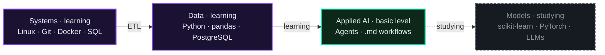

<!--
  PAUQUEN // PROFILE README
  Identity: "pipeline" — systems → data → AI.
  Before publishing: check the TODO for real project repositories.
  Levels are indicative: adjust them to your actual experience.
-->

<div align="center">

```
 ____   _   _   _  ___  _   _ _____ _   _
|  _ \ / \ | | | |/ _ \| | | | ____| \ | |
| |_) / _ \| | | | | | | | | |  _| |  \| |
|  __/ ___ \ |_| | |_| | |_| | |___| |\  |
|_| /_/   \_\___/ \__\_\\___/|_____|_| \_|
```

<strong><code>systems</code> ──▶ <code>data</code> ──▶ <code>artificial intelligence</code></strong>

<em>Systems Engineer focused on Data Analysis and Artificial Intelligence. Continuous learning through hands-on practice.</em>

<br>

<a href="https://github.com/Pauquen"></a>
<a href="https://github.com/Pauquen"></a>
<a href="https://github.com/Pauquen"></a>

</div>

---

## About

I'm **Paulo**, a systems engineer working toward a focus in data analysis and artificial intelligence.

My goal is to understand the full lifecycle of data — from where it comes from to how it supports decisions. I learn through practice, documentation and continuous review.

---

## Path



🟢 **Practicing (basic)** · 🟣 **Learning** · ⚪ **Studying, no hands-on experience yet**

The transition is continuous: systems fundamentals provide rigor, data provides context, and AI provides tools for analysis and prediction.

---

## Stack

| Area | Tools | Level |
| :--- | :--- | :--- |
| **Systems** | Linux · Git · Docker · SQL | learning |
| **Data** | Python · pandas · PostgreSQL · Power BI | learning |
| **Applied AI** | Agents · Markdown workflows · coding assistants | basic |
| **Models (in study)** | scikit-learn · PyTorch · language models | learning |

<div align="center">


</div>

---

## Currently

- **Studying:** SQL analytics, data cleaning and supervised models
- **Practicing:** agents and Markdown-based workflows
- **Goal:** an end-to-end data → model → decision pipeline

---

## Projects

Repositories available for review:

- [Pauquen](https://github.com/Pauquen/Pauquen) — this profile, updated on an ongoing basis.

<!-- TODO: add 2 or 3 real repositories: a data analysis project, a model and a systems project. -->

---

## Contact

- **GitHub:** [@Pauquen](https://github.com/Pauquen)
- **LinkedIn:** [Profile](https://www.linkedin.com/in/paulo-quenta-ahumada-b79324307/)
- **Email:** <estequentaa@gmail.com>
